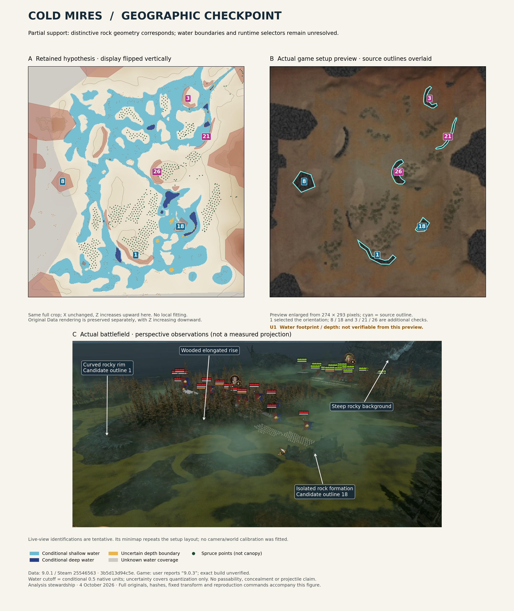

# Cold Mires: one-map geographic checkpoint

**Decision: partially supported.** The retained hypothesis matches several distinctive rock shapes and their relative positions in Owen's game setup preview after reversing its vertical display direction. The battlefield screenshot's minimap repeats that layout. This supports an initial geographic comparison, not certified world geometry or complete current-build compatibility.



[Raw preview beside overlay](figures/cold-mires-preview-overlay.png) · [Original battlefield capture](reference/game-battlefield-original.png) · [Original setup capture](reference/game-setup-original.png) · [Unchanged Data hypothesis illustration](reference/data-hypothesis-original.png)

## Geographic account

In the **game-preview drawing frame**, an elongated wooded rise occupies the lower centre, ending in a curved rocky rim (source outline 1). A separate compact outcrop (18) lies to its right; a rock cluster (8) lies farther left near the middle of the drawing. Smaller curved features occupy the centre-right (26) and upper-right (3 and 21). The decoded elevation hypothesis puts a prominent high rise against the upper-left edge, smaller rises within the basin, and higher ground along the right margin. Those height and slope relationships are source-model interpretations; the small preview does not independently measure them. The perspective screenshot visibly corroborates a wooded raised area with an exposed curved rim, a separate jagged rock formation, and steep rocky scenery in the right background. That background scenery is not independently bound to the modeled right margin. All directions here are drawing-relative, not compass bearings.

The source model predicts branching water around raised patches, but the overhead preview does **not** clearly reproduce this water footprint. The live screenshot shows mottled low ground and marsh-like surfaces; it supplies no tooltip or calibrated shoreline/depth measurement. We cannot validate the predicted shallow/deep boundary, assign water classes to its colors, or infer a dry surface from the brown preview. Raw-zero source water remains unknown.

## Fixture and provenance

- Data: [immutable package at `3b5d13d94c5ed3eb4b9c6ce61cc75854b4426196`](https://github.com/OwenTanzer/CTW-data/tree/3b5d13d94c5ed3eb4b9c6ce61cc75854b4426196/docs/development/battlefields/cold-mires), retained patch **9.0.1 / Steam 25546563**. `source_lock.json` pins consumed files and all five native source identities/hashes.
- Configured key: `chs_wastes_coast_a_01`; atlas key: `battle:chs_wastes_coast_a_01`; map path: `terrain\battles\chs_wastes_coast_a\`; catchment: `catchment_01`; candidate tile: `tile_11`; candidate vegetation: `def_bleak`. The exact atlas row has null `tile_upgrade`; no `battle_group_maps` row was found for this exact key. No group is invented or inferred from a neighboring variant.
- Setup capture visibly identifies **Cold Mires – Chaos Coast**, **Skirmish vs A.I. / Land Battle**, **Ultra**, **Normal**, **60 Minutes**, **Default Funds**, with Bretonnia on both sides. Visible realism, large armies and unit caps boxes are unchecked. Internal catchment, tile-upgrade and vegetation selectors are not exposed by the screenshot.
- Owen supplied the battlefield and setup images on October 4, 2026, at approximately 16:48 and 16:52 Pacific. Those are receipt times, not image-capture timestamps. Original 1920 × 1200 PNGs are retained byte-for-byte, with upload identities and SHA-256 hashes in `evidence.json`.
- Owen said, “The latest i think it 9.0.3.” **9.0.3 is uncertain user-reported provenance**, not an inspected build. Runtime Steam build, mods, and consumed-asset hashes are unavailable. Compatibility is corroborated only at the visible geometry level described below; the historical dataset is not relabeled.

This study belongs to CTW-analysis. Its study-local lock is independent of the older root lock used by the race study; that lock and all downstream consumer pins are unchanged. No PR #41 catalog or source pin is adopted.

## Alignment and checks

The actual overhead image is the **lower-right map setup preview**, not the landscape panorama above it. Extracted pixel rectangle is half-open `(1481,546)–(1755,839)`, giving **274 × 293 pixels**. Its small size limits edge precision.

The full native crop X[1088,2048), Z[1536,2560) maps to preview pixel-edge coordinates by:

```text
u = (X − 1088) × 274 / 960
v = (2560 − Z) × 293 / 1024
```

This is a fixed full-crop display mapping. It reverses top/bottom relative to the original illustration, without changing X, sampling, calibration or underlying source data. There is no individual landmark adjustment, fitted rotation, translation refinement or local warp. The original illustration remains preserved. This is a comparison view, **not a demonstrated decoder defect or a Data correction**.

Outline 1 first suggested the vertical reversal. Outlines 8 and 18 then provided additional spatial checks; outlines 3, 21 and 26 supplied further shape checks. Their agreement distinguishes this layout from a single generic silhouette. This is retrospective visual assessment, not a blinded holdout experiment. No subpixel residual or physical-distance accuracy is claimed.

| Source feature | Independent preview observation | Finding |
| --- | --- | --- |
| 1 | Lower-centre curved rim, open toward the elongated vegetation cluster | Orientation anchor; shape and position agree |
| 8 | Compact rock cluster at drawing-left, about mid-height | Additional position/outline check agrees |
| 18 | Isolated rock to the right of the elongated cluster | Additional check agrees |
| 3 | Small upper-right crescent | Additional shape check agrees |
| 21 | Long right-hand curved feature below 3 | Additional shape/position check agrees |
| 26 | Centre-right C-shaped feature enclosing vegetation | Additional shape/position check agrees |
| Vegetation | Several clusters occupy corresponding regions | Qualitative agreement only; no individual tree matching or proof of active `def_bleak` selection |
| Elevation | Preview shading is low resolution; perspective view shows a raised wooded area | Broad support only; heights, smaller rises and exact slopes not independently calibrated |
| Water | Predicted cyan/blue footprint is not clearly depicted in the preview | Unresolved; neither confirmed nor disproved by preview colors |

The candidate polygons are not exact tracings of the visible rock texture: for example, outline 8 encloses a somewhat larger area than the dark cluster in the preview. At this resolution this is a visible boundary discrepancy, not a demonstrated collision error. Small offsets and vegetation differences are not resolved.

The retained orientation **without** the vertical reversal places outline 1 near the top instead of near the bottom, and outline 3 near the bottom instead of the top. A 180-degree rotation additionally sends the observed left-hand cluster 8 to the right. An X-only mirror leaves the top/bottom disagreement and swaps left/right. These qualitative contradictions favor the shown vertical reversal. Arbitrary affine/projective alternatives were not exhaustively searched or ruled out.

The live-view minimap repeats the distinctive crescent/cluster pattern seen in setup, supporting continuity between the captures. In the perspective panel, outline-1 and outline-18 assignments remain **candidates**: no camera projection or native point measurement was fitted. The main rock/vegetation correspondences are established against the separately shown overhead preview.

## Unknowns and restrictions

Water classes retain the **conditional 0.5-native-unit cutoff**, with a quantization-only uncertainty band; neither metre equivalence nor the runtime threshold is established. Vegetation points are not forest, canopy or concealment boundaries; alternative sets are not combined. Candidate outlines and building origins are not certified collision footprints. The figure provides no passage, choke-point, concealment, projectile-obstruction or combat-effect claim. Coverage disagreement and tiny unmatched marks remain unresolved.

## Verification and reproduction

The authorized cloud checkout was clean Data `main` at the pinned commit. There were no `.agents/skills` files. Repository instructions, catalog, the Cold Mires package, current #9/#37 scope and #39 closeout were read. Open Data/Analysis PRs and open Data issues plus the Cold Mires task search revealed no duplicate comparison. No MSI service or security setting was changed.

Already executed from that Data checkout in this task:

```sh
python scripts/cold_mires/build.py --output work/cold-mires-check-20261004
python scripts/cold_mires/render.py --dataset work/cold-mires-check-20261004 --output work/cold-mires-check-20261004/map.png
python scripts/cold_mires/test_map.py
python scripts/cold_mires/test_rebuild.py
git diff --check
```

Build and render passed; **6 map tests + 5 rebuild tests passed**. The builder verifies the five pinned native inputs; rebuild tests establish exact array/vector reconstruction. Focused results do not certify game alignment or full-repository health. No full repository test suite or runtime movement/calibration session was performed.

From Analysis, with the pinned Data checkout alongside:

```sh
python src/ctw_analysis/cold_mires_comparison.py --data-root ../CTW-data
```

The comparison generator checks the exact Data commit, 20 consumed source/file hashes and 3 retained reference hashes before drawing. Python/NumPy/Matplotlib versions and command outcomes are recorded in `evidence.json`. PNG byte identity across plotting-library versions is not required. Both generated figures were inspected as pixels for alignment and readable annotations.

## Smallest remaining work

For #9, obtain a build-identified, tooltip-bearing view of one recognizably matched shoreline or water interior to check a geographically located water claim. For #37, confirm the internal variant binding and one additional independently recorded spatial reference before promoting the preview display relation to a world-coordinate contract. Exact runtime build/consumed-asset compatibility remains a separate gap. Neither requires more maps or the full movement/combat session.

No source-data correction is justified by this comparison. #9/#37 remain open; #39 stays completed. PR #38 is not revived, PR #41 is untouched, and no organizational acceptance is claimed.
